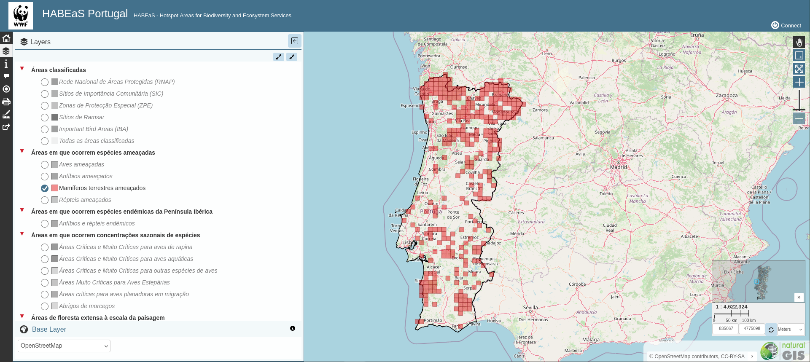

**What is it?**

From 2011 to 2022, I coordinated the [HABEaS Project (Hotspot Areas for Biodiversity and Ecosystem Services)](https://mapas.wwf.pt/) which is a free online geographic information system that provides free access to data on biodiversity and ecosystem services in Portugal. The platform enables landowners, NGOs, forest managers, and environmental agencies to access key information on protected areas, endangered and endemic species, rare habitats, carbon storage, erosion risk, and aquifer recharge zones.

 Figure 1 - Distribution of threatened mammals in HABEaS.

**Impact**

HABEaS WebGIS played a critical role in WWF Portugal’s [Green Heart of Cork (GHoC)](https://wwfeu.awsassets.panda.org/downloads/ghoc10yearsapproved.pdf), a landscape initiative to conserve the world’s largest continuous cork-oak woodland across the Tejo & Sado basins (≈500,000 ha), which also overlies the Iberian Peninsula’s largest aquifer (T3). The platform was used to identify biodiversity and ecosystem-service “hotspots” and to target conservation actions where they would have the greatest impact.

GHoC operates through a Payments for Ecosystem Services (PES) scheme in which companies financially reward landowners who practice [Forest Stewardship Council (FSC)](https://www.pt.fsc.org/) certified sustainable forest management in those hotspot areas. WWF used HABEaS WebGIS to pinpoint priority sites and then brokered agreements between buyers and landholders—among the sponsors were Coca-Cola Portugal (Refrige), Jerónimo Martins, and Onyria. Between 2011 and 2021, these PES agreements amounted to **€79,000**.
